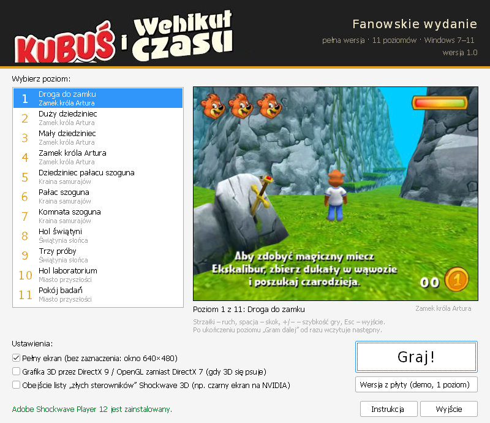
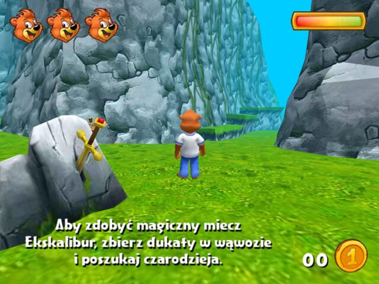
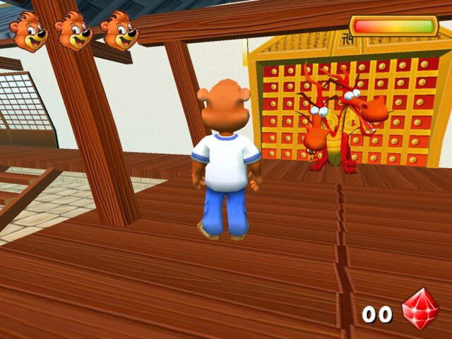

# Kubuś i Wehikuł Czasu – fanowskie wydanie

<p align="center">
  
</p>

Polska przygodowa gra 3D z Kubusiem, wydana na płycie CD (wersja demo z jednym poziomem),
a kolejne etapy pobierało się ze strony kubus.pl. Strona już nie działa, a gra na współczesnym
Windowsie działała kilka razy za szybko, zmieniała rozdzielczość monitora i nie dało się
przejść do kolejnego poziomu.

To repozytorium zbiera **pełną wersję (11 poziomów)** w jednym miejscu, poprawia ją tak, żeby
dało się w nią normalnie zagrać, i pakuje ją w instalator z wygodnym launcherem.

**[⬇ Pobierz najnowsze wydanie](https://github.com/Hayyarden/Kubus-i-Wehikul-Czasu/releases/latest)** – instalator albo wersja przenośna (ZIP).

> To nieoficjalny, niekomercyjny projekt fanów. Szczegóły w sekcji [Informacja prawna](#informacja-prawna).

---

## Spis treści

- [O grze](#o-grze)
- [Jak zagrać](#jak-zagrać)
- [Sterowanie](#sterowanie)
- [Gdy coś nie działa](#gdy-coś-nie-działa)
- [Co zostało poprawione](#co-zostało-poprawione)
- [Zrzuty ekranu](#zrzuty-ekranu)
- [Dla twórców: budowanie i struktura repozytorium](#dla-twórców)
- [Stan testów](#stan-testów)
- [Informacja prawna](#informacja-prawna)
- [English summary](#english-summary)

## O grze

Kubuś wsiada do wehikułu czasu i odwiedza cztery światy, zbierając po drodze magiczne
przedmioty: miecz Ekskalibur, Oko Smoka i Amulet Słońca.

| Świat | Poziomy |
|---|---|
| Zamek króla Artura | 1. Droga do zamku · 2. Duży dziedziniec · 3. Mały dziedziniec · 4. Zamek króla Artura |
| Kraina samurajów | 5. Dziedziniec pałacu szoguna · 6. Pałac szoguna · 7. Komnata szoguna |
| Świątynia słońca | 8. Hol świątyni · 9. Trzy próby |
| Miasto przyszłości | 10. Hol laboratorium · 11. Pokój badań |

Grę wykonało studio VERUM.COM, a na okładce widnieje © MGD Sp. z o.o.

## Jak zagrać

Wymagania: Windows 7, 8, 10 lub 11 (32- albo 64-bitowy), karta graficzna z obsługą 3D.

### Instalator (polecany)

1. Pobierz `Kubus-i-Wehikul-Czasu-<wersja>-instalator.exe` z
   [wydań](https://github.com/Hayyarden/Kubus-i-Wehikul-Czasu/releases/latest) i uruchom go.
2. Zostaw zaznaczony **Adobe Shockwave Player 12.3**, jeśli go nie masz. Bez niego pełna wersja
   nie ruszy. Instalator dołącza oryginalny, niezmieniony instalator Adobe.
3. Uruchom grę skrótem „Kubuś i Wehikuł Czasu”, wybierz poziom i kliknij **Graj!**

Instalator dodaje skróty w Menu Start i na pulpicie oraz wpis w „Aplikacje i funkcje”, więc grę
można normalnie odinstalować. Shockwave Player zostaje wtedy w systemie, bo mogą go używać inne gry.

### Wersja przenośna (ZIP)

1. Pobierz `Kubus-i-Wehikul-Czasu-<wersja>.zip` i rozpakuj go w dowolnym miejscu.
2. Uruchom `Kubus.exe`.
3. Jeśli na dole okna widać „Brak Adobe Shockwave Player 12”, kliknij **Zainstaluj Shockwave 12**.

### Prosto z repozytorium

Pobierz repozytorium (Code → Download ZIP) i uruchom `pelna_wersja/Kubus.exe`. Launcher sam
znajdzie instalator Shockwave w folderze z archiwum.

### Launcher

- lista 11 poziomów z podglądem, zapamiętuje ostatnio wybrany poziom,
- pełny ekran albo okno 640×480,
- dwa przełączniki dla problematycznych kart graficznych (opisane [niżej](#gdy-coś-nie-działa)),
- sprawdza, czy jest Shockwave Player 12, i w razie potrzeby go instaluje,
- przycisk **Wersja z płyty** uruchamia poprawioną wersję demo z płyty CD (1 poziom), która
  działa bez Shockwave Playera.

Ustawienia są zapisywane w `%APPDATA%\Kubus i Wehikul Czasu\ustawienia.ini`.

## Sterowanie

| Klawisz | Działanie |
|---|---|
| Strzałki | ruch |
| Spacja | skok |
| `+` / `-` (także na klawiaturze numerycznej) | szybsza / wolniejsza gra (co 5 kl./s, od 10 do 80) |
| `Esc` | ekran wyjścia (Tak / Nie) |
| `Alt+F4` | awaryjne zamknięcie |

Gra startuje z tempem 30 kl./s. Tempo zmienione klawiszami przechodzi na kolejne poziomy.
Po ukończeniu poziomu przycisk **Gram dalej** od razu wczytuje następny.

## Gdy coś nie działa

| Objaw | Co zrobić |
|---|---|
| Czarny ekran zamiast gry | W launcherze zaznacz **Obejście listy „złych sterowników”** (częste na kartach NVIDIA). Jeśli nie pomoże, zaznacz też **Grafika 3D przez DirectX 9 / OpenGL**. |
| Grafika 3D migocze, brakuje modeli | Zaznacz **Grafika 3D przez DirectX 9 / OpenGL**. |
| Gra za szybka albo za wolna | Klawisze `+` i `-` w trakcie gry. |
| „System Windows ochronił ten komputer” (SmartScreen) | Pliki nie są podpisane cyfrowo. Kliknij **Więcej informacji → Uruchom mimo to**. |
| Pełna wersja w ogóle nie rusza | Spróbuj przycisku **Wersja z płyty**. Działa bez Shockwave Playera. |

Nie włączaj trybu zgodności dla `Kubus.exe` ani plików gry. Nie jest potrzebny, a stare
ustawienia (np. „Uruchom w rozdzielczości 640×480”) mogą przeszkadzać.

Zapasowy sposób uruchamiania bez launchera to `Graj.cmd` w folderze z poziomami (menu w konsoli,
`Graj.cmd 5 okno` uruchamia poziom 5 w oknie).

Jeśli trafisz na błąd, [zgłoś go](https://github.com/Hayyarden/Kubus-i-Wehikul-Czasu/issues).
Napisz, jaką masz wersję Windowsa i kartę graficzną.

## Co zostało poprawione

Grafika, dźwięk i treść gry są oryginalne. Zmieniono tylko to, co było potrzebne, żeby gra
działała na współczesnym komputerze.

### Pełna wersja (11 poziomów, pliki `.dcr`)

| Problem | Przyczyna | Poprawka |
|---|---|---|
| Wszystko działa kilka razy za szybko | Ruch postaci jest liczony na klatkę, a poziomy mają tempo 150–200 kl./s | Stałe tempo 30 kl./s i regulacja klawiszami `+`/`-` |
| „Gram dalej” nic nie robi, „Zakończ” otwiera stronę | Przyciski wołały nieistniejącą stronę `kubus.pl/zapisz_graj.php` | „Gram dalej” wczytuje następny poziom, „Zakończ” zamyka grę |
| Czarny ekran w odtwarzaczu | SPR domyślnie ładuje gry przez serwer proxy Flashpointa | Proxy wyłączone, użyty wariant SPR dla Shockwave 12 |
| Malutki obraz | – | Obraz 4:3 rozciągnięty na cały ekran |
| Poziom 1: nie da się wziąć miecza Ekskalibur | Czar siły był zapisywany tylko wtedy, gdy Kubuś stał przy czarodzieju w określonym momencie animacji | Czar jest nadawany zawsze po zaklęciu czarodzieja |

### Wersja z płyty (`Kuba.exe`, 1 poziom)

| Problem | Poprawka |
|---|---|
| Główny monitor przełączał się na 640×480, a gra uciekała na drugi ekran | Wyłączony element zmieniający tryb ekranu |
| Kubuś biega i obraca się kilka razy za szybko | Stałe tempo 30 kl./s i regulacja `+`/`-` |
| Malutki obraz | Powiększenie do największego prostokąta 4:3 na ekranie |
| Przy skoku na wyższą platformę Kubuś „wybijał się drugi raz” | Łuk skoku jest liczony od wysokości, z której Kubuś się wybił |

Szczegółowy opis zmian: [`pelna_wersja/CZYTAJ_MNIE.md`](pelna_wersja/CZYTAJ_MNIE.md) i
[`poprawka/CZYTAJ_MNIE.md`](poprawka/CZYTAJ_MNIE.md).

## Zrzuty ekranu

<table>
  <tr>
    <td></td>
    <td></td>
    <td></td>
  </tr>
  <tr>
    <td></td>
    <td></td>
    <td></td>
  </tr>
  <tr>
    <td></td>
    <td></td>
    <td></td>
  </tr>
</table>

## Dla twórców

### Struktura repozytorium

| Ścieżka | Zawartość |
|---|---|
| `pelna_wersja/` | Poprawione poziomy `.dcr`, odtwarzacz SPR, `Kubus.exe` (launcher) i `Graj.cmd` |
| `poprawka/` | Poprawiony `Kuba.exe` z płyty CD (wersja demo, 1 poziom) |
| `launcher/` | Kod launchera (C, Win32) i jego grafiki |
| `installer/` | Skrypt instalatora NSIS i jego grafiki |
| `tools/kubus_dcr_patch.py` | Patcher poziomów pełnej wersji (Python 3, bez zależności) |
| `tools/kubus_patch.py` | Patcher `Kuba.exe` z płyty |
| `tools/zbuduj_wydanie.sh` | Buduje ZIP i instalator do `dist/` |
| `docs/` | Instrukcja dla graczy (`CZYTAJ_MNIE.txt`), opis wydania, zrzuty ekranu |
| `Kubus3D/` | Oryginalna instalacja z płyty CD (niezmieniona) |
| `kubus-i-wehiku-czasu-…/` | Oryginalne archiwum z Internet Archive: niezmienione poziomy, instalator Shockwave 12.3, warianty SPR, zdjęcia płyty |

### Budowanie

Wszystko buduje się na Linuksie (albo w WSL):

```sh
sudo apt install gcc-mingw-w64-i686 nsis zip

launcher/build.sh              # tylko launcher -> pelna_wersja/Kubus.exe
tools/zbuduj_wydanie.sh        # launcher + dist/*.zip + dist/*-instalator.exe + SHA256SUMS.txt
tools/zbuduj_wydanie.sh 1.1    # to samo z inną wersją (domyślnie z pliku WERSJA)
```

Poziomy i `Kuba.exe` generuje się z oryginałów patcherami:

```sh
python tools/kubus_dcr_patch.py "<folder z oryginalnymi .dcr>" pelna_wersja --fps 30
python tools/kubus_patch.py Kubus3D/Kuba.exe poprawka/Kuba.exe --fps 30
```

### Nowe wydanie na GitHubie

Workflow [`.github/workflows/wydanie.yml`](.github/workflows/wydanie.yml) buduje paczki na
GitHub Actions:

```sh
echo 1.1 > WERSJA            # opcjonalnie, numer i tak bierze się z tagu
git tag v1.1
git push origin v1.1
```

Po kilku minutach w zakładce **Releases** pojawi się szkic wydania (draft) z instalatorem, ZIP-em
i sumami kontrolnymi. Wystarczy go przejrzeć i kliknąć **Publish**. Workflow można też uruchomić
ręcznie (Actions → Wydanie → Run workflow), wtedy pliki trafiają do artefaktów.

## Stan testów

- Launcher, instalator i deinstalator były sprawdzane pod **Wine 9** (Linux): instalacja razem
  z Shockwave 12.3, skróty, start poziomów na pełnym ekranie i w oknie, oba przełączniki
  grafiki 3D, wersja z płyty, powrót do launchera po zamknięciu gry, zapamiętywanie ustawień,
  czyste odinstalowanie.
- Poprawki gry były sprawdzane pod Wine (szczegóły w plikach `CZYTAJ_MNIE.md`).
- **Na prawdziwym Windowsie całość nie była jeszcze testowana.** Jeśli zagrasz, daj znać w
  [Issues](https://github.com/Hayyarden/Kubus-i-Wehikul-Czasu/issues), czy wszystko działa.

## Informacja prawna

- To **nieoficjalne, niekomercyjne wydanie fanowskie** gry, która od lat nie jest sprzedawana
  ani wspierana (abandonware). Ma pozwolić zagrać w nią na współczesnym komputerze.
- Prawa do gry, postaci i znaków należą do ich właścicieli (na okładce: © MGD Sp. z o.o.,
  projekt i wykonanie VERUM.COM). Projekt nie jest z nimi związany ani przez nich wspierany.
- Wydanie jest darmowe. Nie wolno go sprzedawać.
- **Jeśli jesteś właścicielem praw** i chcesz, żeby to wydanie zostało usunięte, załóż
  [zgłoszenie](https://github.com/Hayyarden/Kubus-i-Wehikul-Czasu/issues). Zostanie usunięte.

Dołączone programy innych autorów:

- Flashpoint Shockwave Projector Redirector (SPR), Anthony Kleine – licencja MIT ([`pelna_wersja/SPR_LICENSE.txt`](pelna_wersja/SPR_LICENSE.txt)),
- Adobe Shockwave Player 12.3 – oficjalny, niezmieniony instalator Adobe (`sw_lic_full_installer.msi`).

Podziękowania dla osoby, która zachowała pełną wersję i udostępniła ją w Internet Archive, oraz
dla twórców projektu [Flashpoint](https://flashpointarchive.org/).

## English summary

**Kubuś i Wehikuł Czasu** (*Kubuś and the Time Machine*) is a Polish 3D adventure game for kids,
made with Macromedia Director / Shockwave 3D. The CD contained a one-level demo, and the other
levels were downloaded from kubus.pl, which no longer exists.

This is an unofficial, non-commercial fan re-release of the full game (11 levels) for modern
Windows. It ships with a launcher and an installer, and fixes the original's problems: the game
running several times too fast (movement is per-frame), forced 640×480 display mode,
level-to-level transitions that pointed at the dead website, and two gameplay bugs. Download the
installer or the portable ZIP from
[Releases](https://github.com/Hayyarden/Kubus-i-Wehikul-Czasu/releases/latest). Adobe Shockwave
Player 12 is required and is bundled. The game itself is in Polish.

All rights to the game belong to their respective owners. If you hold the rights and want this
removed, please open an issue.
